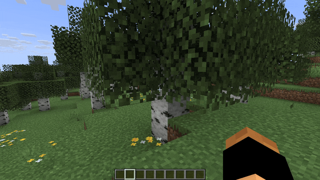
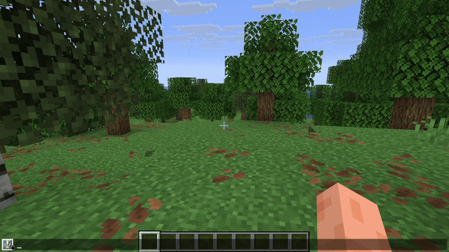
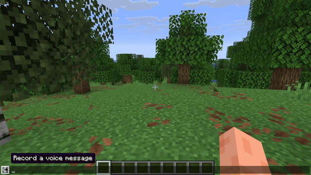
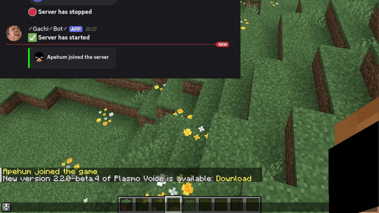

<div>
    <a href="https://modrinth.com/mod/plasmo-voice">Plasmo Voice</a>
    <span> | </span>
    <a href="https://modrinth.com/plugin/pv-addon-voice-messages">Modrinth</a>
    <span> | </span>
    <a href="https://www.curseforge.com/minecraft/mc-mods/pv-addon-voice-messages">CurseForge</a>
    <span> | </span>
    <a href="https://github.com/Apehum/pv-addon-voice-messages/">GitHub</a>
    <span> | </span>
    <a href="https://discord.com/invite/uueEqzwCJJ">Discord</a>
     <span> | </span>
    <a href="https://www.patreon.com/plasmomc">Patreon</a>
</div>


# pv-addon-voice-messages

[Plasmo Voice](https://github.com/plasmoapp/plasmo-voice) addon that adds voice messages.



## Client mod

Client-side mod adds handy recording interface in chat, so you don't have to use commands for recording.
Playback is still handled via commands, but UI for playback is planned too.



Send button sends to the chat by default, right-click it to pick where to send instead:



The mod is completely optional, without it voice messages will still work via commands.

## Commands

- `/vm` — Record and send a voice message to all players (same as `/vm default`)
- `/vm default` — Record and send a voice message to all players
- `/vm direct <player>` — Record and send a voice message to a specific player (NOTE: anyone with voice message id can listen your voice message, so it's not fully private)

## Permissions
- `pv.addon.voice_messages.play` — Play voice messages (default true)
- `pv.addon.voice_messages.record.default` — Record and send global voice messages (default true)
- `pv.addon.voice_messages.record.direct` — Record and send direct voice messages (default true)
- `pv.addon.voice_messages.record.*` — Record and send voice messages in any context (default OP)

## Configuration

The configuration file is located at `plugins/pv-addon-voicemessages/config.toml` (`/config/pv-addon-voicemessages/config.toml` for Fabric/Forge/NeoForge).

```toml
# Activation to use for recording
activation = "proximity"
# Maximum duration of voice message
max_duration_seconds = 60
# How long recorded voice messages will be stored
expire_after_minutes = 10
# Whether actionbar text should be shown when recording a voice message
actionbar_when_recording = true
# Source line weight controls sorting order in "Volume"
# Higher weights are placed at the bottom of the list
source_line_weight = 100
# Whether packetevents chat integration should be used
# Only works on Paper-based servers with packetevents installed,
# otherwise integration won't be loaded
# 
# If enabled, addon will send messages "as player" and they'll be formatted with installed chat plugin
use_packet_events_integration = true
# Available storage types: [MEMORY, REDIS]
storage_type = "MEMORY"

[chat_format]
default = "<lang:chat.type.text:'<player_name>':'<voice_message>'>"
direct_incoming = "<italic><gray><lang:commands.message.display.incoming:'<source_player_name>':'<voice_message>'>"
direct_outgoing = "<italic><gray><lang:commands.message.display.outgoing:'<target_player_name>':'<voice_message>'>"

# Redis configuration (required if storageType is REDIS)
#[redis]
#host = "localhost"
#port = 6379
#user = ""
#password = ""
```

## DiscordSRV

Paper plugin has integration with DiscordSRV.
Voice messages sent in the Discord channel will be playable in the game chat, and vice versa:


## API

[](https://central.sonatype.com/artifact/dev.apehum.voicemessages/api)

```kotlin
repositories {
    mavenCentral()
}

dependencies {
    compileOnly("dev.apehum.voicemessages:api:$VERSION")
}
```

See [api-example](https://github.com/apehum/pv-addon-voice-messages/tree/main/api-example) for basic usage.
